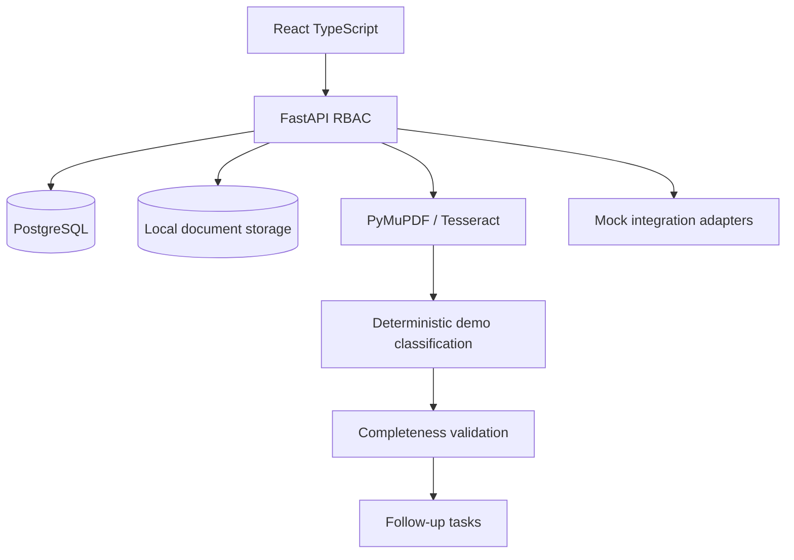

# Architecture

This initial implementation processes documents synchronously. Redis/Celery are planned for asynchronous processing, and an external LLM adapter is not yet implemented. Do not use with real PHI.
