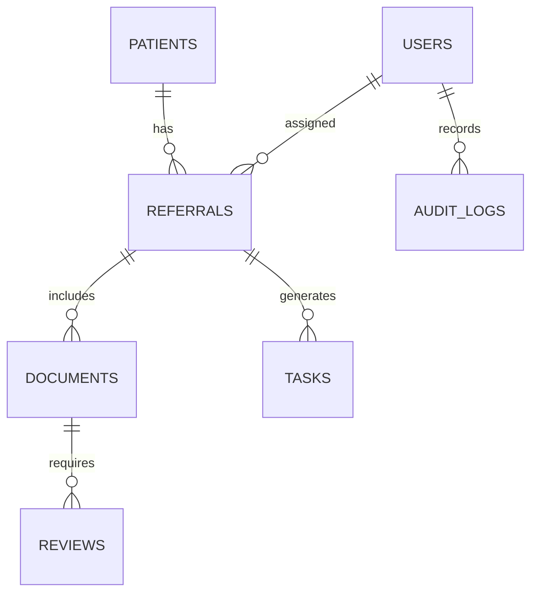

# Data model

Current tables: users, patients, referrals, documents, tasks, reviews, audit_logs, integration_logs. The full normalized schema from the specification and Alembic migrations remain future work.
