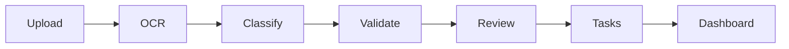

# Demo workflow

1. Log in as admin.
2. Create a fictional ABA referral.
3. Upload a synthetic PDF linked to that referral.
4. Process the document; the demo extractor identifies basic fields and missing signatures.
5. Inspect the review queue and approve/reject.
6. Validate referral requirements and inspect generated follow-up tasks.
7. Inspect dashboard, audit history, and mock integration logs.

